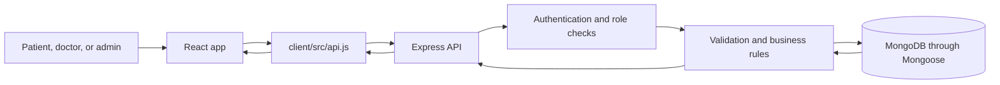
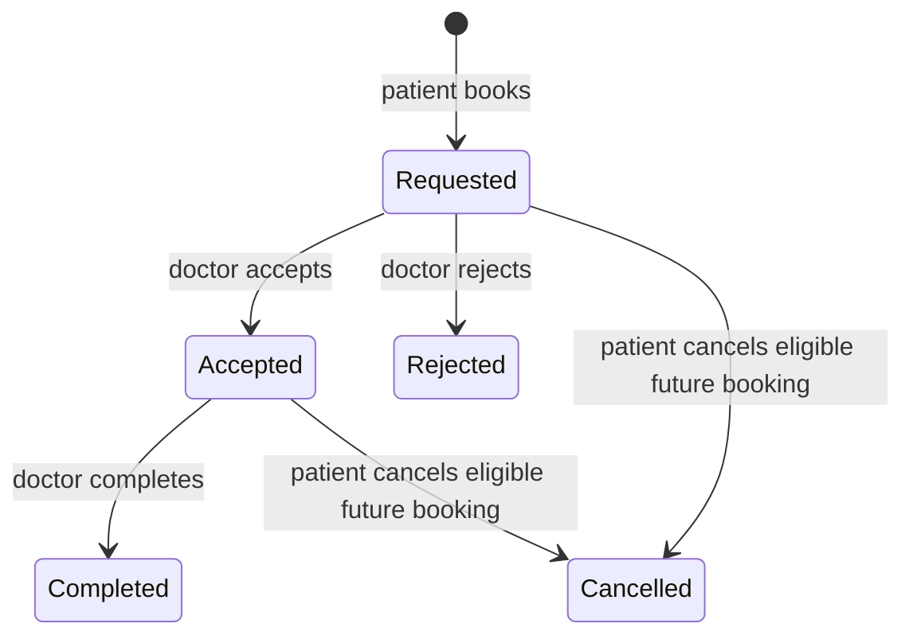

# MediBook student and presentation guide

This guide is for learning and explaining the project. You do not need to memorize every function. Be ready to explain the main request flow, where the rules are enforced, and why the application protects appointment slots.

## The app in one minute

MediBook helps patients find doctors and request appointments. A doctor reviews and updates those requests. An administrator can provision doctor accounts and see basic system information. React displays the screens, Express handles requests and rules, and MongoDB stores the records.

## A useful way to read the repository

Read one feature from the screen to the database. For example, to understand booking:

1. `client/src/App.jsx` contains the patient screens and the booking interaction.
2. `client/src/api.js` sends the request to the backend and adds the saved login token.
3. `server/src/routes/appointments.js` protects the booking route and hands it to the service.
4. `server/src/services/appointmentService.js` validates the selected slot and applies booking rules.
5. `server/src/models/Appointment.js` describes how the appointment is stored and adds the final duplicate-slot safeguard.

Other useful files:

| File | What it does |
| --- | --- |
| `client/src/main.jsx` | Starts React and displays the main app. |
| `client/src/App.jsx` | Patient and doctor screens, navigation, and UI state. |
| `client/src/AdminDashboard.jsx` | Admin screens for statistics, users, appointments, and doctors. |
| `client/src/styles.css` | Shared colors, layout, components, and responsive rules. |
| `server/src/app.js` | Creates the Express app and connects each route group. |
| `server/src/index.js` | Checks startup configuration, connects to MongoDB, and starts the HTTP server. |
| `server/src/routes/` | Maps HTTP paths to authentication checks and backend services. |
| `server/src/services/` | Holds the main appointment, doctor-dashboard, and admin rules. |
| `server/src/models/` | Defines the MongoDB document shapes. |
| `server/src/middleware/auth.js` | Checks the login token and role for protected routes. |
| `docs/api.md` | Exact endpoint, request, and response details. |
| `docs/architecture.md` | More technical design and security notes. |

## What the three records mean

- **User** is the login account: name, email, bcrypt password hash, role, and active flag. Public sign-up always creates a patient.
- **Doctor** is a professional profile linked to one doctor-role User. It contains the specialty, fee, biography, timezone, and weekly opening hours.
- **Appointment** links a patient User to a Doctor profile. It stores UTC start/end instants, a status, and an optional reason.

The doctor profile links to the doctor account through `Doctor.user`. An appointment links to the patient through `Appointment.patient` and the professional profile through `Appointment.doctor`.

## The important workflows

### Patient booking

1. A patient registers or logs in. The API checks the input, hashes new passwords with bcrypt, and returns a signed JWT after login.
2. The frontend keeps that token in the current browser tab's `sessionStorage`. `api.js` attaches it to protected requests as a Bearer token.
3. The patient searches the public doctor directory and opens a profile.
4. The browser requests slots for a date range. The server reads the doctor's weekly local-time hours and timezone, then returns future 30-minute slots as UTC instants.
5. The patient chooses a slot and submits the doctor ID, slot start, and optional reason. The server calculates the end time itself; it does not trust a patient ID or end time supplied by the browser.
6. A successful request creates a `requested` appointment. The patient can see it in appointment history and can cancel an eligible future appointment.

### Doctor review

The doctor dashboard asks the server for the Doctor profile linked to the logged-in User. The server uses that profile ID to list appointments; it does not trust a doctor ID submitted by the browser. Doctors can accept or reject a requested appointment, and complete an accepted appointment. The status transition is checked on the server.

### Admin work

The admin dashboard is shown after an admin logs in. Its APIs independently require an active admin account, so hiding a button in React is not the security check. The admin can review counts and lists, manage account status within safety rules, and create a doctor login with its linked profile.

## Appointment statuses

Rejected, cancelled, and completed appointments no longer reserve the slot. Appointment history remains in the database after a slot is released.

## Why booking has extra protection

The server checks availability before it saves an appointment. Two people can still choose the same slot at nearly the same time, so the database has a unique sparse index on `activeSlotKey`. The first insert reserves the slot; MongoDB rejects a competing insert, and the API returns a helpful conflict response. This is why the duplicate-booking safeguard is worth keeping even if it looks more advanced than a simple form submission.

Weekly availability is local to the doctor's timezone. Actual appointment instants are stored in UTC. Keeping those separate avoids treating (for example) 10:00 in one timezone as the same instant everywhere. The UI formats the returned instant for the doctor's timezone.

## Suggested live presentation

Use the deployed app and approved demo accounts. Do not show passwords in slides, screenshots, or source code.

1. **Introduce the problem:** patients need to discover doctors and request a time; doctors need to review requests.
2. **Show patient flow:** sign in, search/filter the directory, open a doctor, choose an available slot, and book it.
3. **Show the result:** open patient appointments and explain the `requested` status.
4. **Show the doctor flow:** sign in as that doctor, open the dashboard, and accept or reject the request.
5. **Show the change:** return to the patient appointment list and explain that the status comes from the API/database.
6. **Explain the safeguards:** passwords are hashed; backend roles protect endpoints; the database prevents two active bookings for one slot.
7. **Close with scope:** this release handles appointment discovery and management; it does not handle payments, video calls, medical records, chat, or notifications.

If there is no suitable demo appointment, create one through the app before the presentation. Avoid changing a real person's account or appointment just to prepare the demo.

## Questions students should be ready for

- **Why React and Express?** React renders the browser screens; Express provides one API that enforces the same rules for every client.
- **Why hash passwords?** The database should not contain passwords that can be read directly. Login compares the submitted password with its bcrypt hash.
- **Why check roles on the server?** Browser navigation can be changed by a user. Only backend authorization protects the data and actions.
- **Why does the server calculate appointment end time?** A client must not be allowed to lengthen or alter the booked slot.
- **Why use a database index as well as an availability check?** The index protects against simultaneous requests that both pass an earlier availability read.
- **Why keep tests?** They are not needed to run the website. They check important rules during development and provide examples of expected behavior.

## Tests are for developers, not website visitors

The existing backend tests are run manually from the repository root with `npm test`. The production frontend build can be checked with `npm run build --workspace client`. These commands do not start the website and are not run when someone visits it. For a live presentation, use the deployed frontend; for local development, follow the setup steps in the root README.
